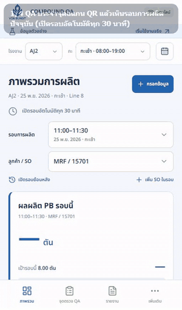
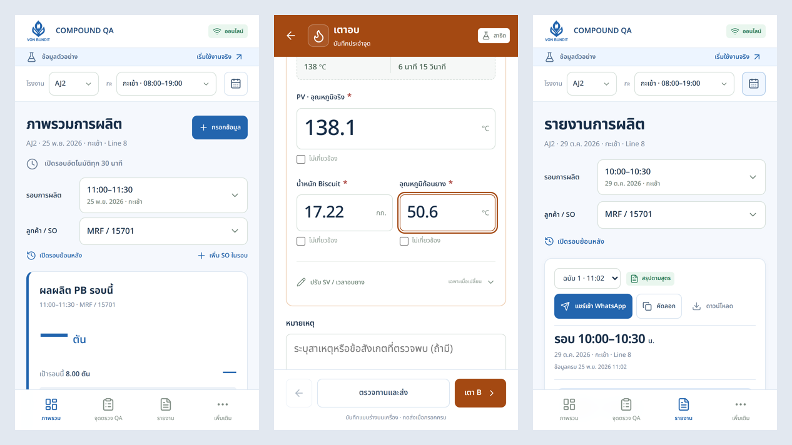
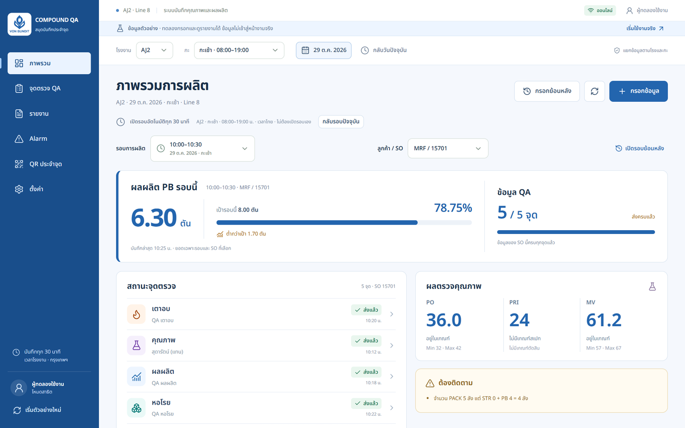
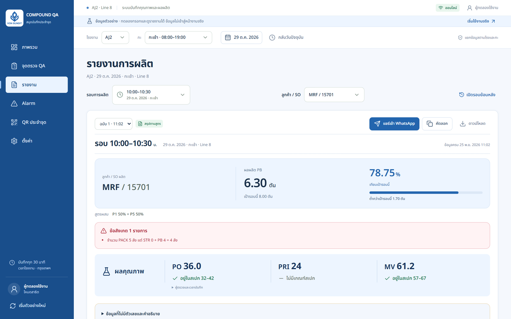

# COMPOUND QA · Production Quality Logbook

A web app that replaces the paper logbooks used at five QA checkpoints on a rubber compound production line (oven, quality lab, production, drying tower and packing/warehouse). Each checkpoint has a QR code. QA staff scan it with a phone and record their readings for the current 30-minute production round. When all five checkpoints have reported, the system builds the round's production report and supervisors share it to their WhatsApp group. It was built for and handed over to the factory in November 2026.

[](docs/media/qa-demo.mp4)

_Preview of the mobile walkthrough. Select it to open the 40-second video (MP4, 1.2 MB). Recorded in the app's built-in demo mode, so every value is sample data._



## What it does

| Area              | Details                                                                                                                                                                                                                   |
| ----------------- | ------------------------------------------------------------------------------------------------------------------------------------------------------------------------------------------------------------------------- |
| Automatic rounds  | Rounds open by themselves every 30 minutes for each factory and shift on factory (Bangkok) time. Supervisors can open a past round to backfill                                                                            |
| Checkpoint forms  | One form per checkpoint, reached by its QR label. Fields check min/max limits as they're typed. Missing values need an explanation, and drafts are saved on the phone until they're sent                                  |
| Production report | Built only when every checkpoint has reported: output against the round target, quality results against spec (PO, PRI, MV), defects by type, packing by sales order, and automatic observations when numbers don't add up |
| Alarms            | Out-of-range values raise alarms that stay open until a corrected value is sent or a supervisor records the fix. The original reading is kept                                                                             |
| Sharing           | Reports go to WhatsApp, the clipboard or a download. Revisions are numbered and keep a change history                                                                                                                     |
| Setup             | Production plan, customers and sales orders, min/max limits per order, users, and printable QR labels for every checkpoint                                                                                                |





## Engineering notes

- **Stack.** React 19, TypeScript, Vite and Tailwind CSS 4 on the frontend. Node.js 24 and PostgreSQL 18 on the server.
- **Unreliable factory Wi-Fi.** Submissions queue on the phone while offline and are sent when the connection returns. A service worker keeps the app usable without a network.
- **Live updates.** Supervisors' screens update through Server-Sent Events as checkpoints report.
- **One domain module.** Rules for rounds, limits, readiness and the report live in `src/shared/domain.mjs`, which both the browser and the server use, so a report computed on the server matches what the phone shows.
- **Architecture checks.** `npm run check` runs formatting, TypeScript, an import-boundary check between features, 21 test files under `node --test`, and the production build.
- **Releases.** GitHub Actions runs the checks against a PostgreSQL service container, then packages a versioned update ZIP with a SHA-256 checksum for the factory server.
- **Windows server kit.** Scripts set up PostgreSQL, start the server on boot, back up and restore data, and update from a release.

## Run the demo locally

Requires Node.js 24. Demo mode runs entirely in the browser, so no database is needed.

```powershell
npm ci
npx vite --host 127.0.0.1
```

Open <http://127.0.0.1:5173/?demo=1>. For the full server with PostgreSQL, follow [docs/README-WINDOWS.md](docs/README-WINDOWS.md) and [docs/POSTGRESQL.md](docs/POSTGRESQL.md) (Thai).

## Project layout

```text
src/app/        App shell and workspace state (rounds, sessions, offline queue)
src/features/   Screens by task: dashboard, QA forms, rounds, reports, alarms, QR labels, settings, demo
src/shared/     Domain rules, API client, UI and report formatting shared by browser and server
src/server/     HTTP server, PostgreSQL access, live updates, alarms and backups
migrations/     Database schema history
scripts/        Build, dev server, release packaging and Windows server tools
tests/          Rules, data, permission and report tests
```

The original Thai README is in [README_TH.md](README_TH.md).
